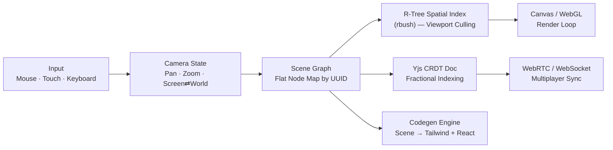

<div align="center">

# Vektor

**An open-source, local-first infinite canvas for design — built from scratch in TypeScript, with CRDT multiplayer and a compiler that outputs clean Tailwind and React instead of inline styles.**

Vektor is a vector design tool for people who'd rather own their files than rent a browser tab. No account, no cloud lock-in, no screenshot-and-guess handoff to developers — just a fast canvas, a scene format you can `git diff`, and layers that compile straight to code.


[](LICENSE)


[](#-contributing)
[](https://github.com/Talha-Yaseen-Hub/Vektor/stargazers)

**[Follow the repo](https://github.com/Talha-Yaseen-Hub/Vektor)** to catch new phases as they ship — built in public by [Talha Yaseen](https://talha-yaseen.vercel.app/).

</div>

---

<!-- HERO IMAGE — place your cursor on the line below, delete this italic text, then drag your screenshot or GIF in. GitHub will insert it automatically. -->
*📸 Drop your hero screenshot or GIF here — the canvas mid-edit is the best first impression.*


*Vektor's canvas — replace this caption once the image is in.*

---

> [!NOTE]
> **Vektor doesn't have a community yet — you could be one of the first.** Open an [issue](https://github.com/Talha-Yaseen-Hub/Vektor/issues), start a [discussion](https://github.com/Talha-Yaseen-Hub/Vektor/discussions), or fork it and see what you'd build. This early, contributors shape the architecture — they don't just patch it.

[Features](#-features) · [Everything in the Box](#-everything-in-the-box) · [The Scene Format](#-the-scene-format) · [Under the Hood](#-under-the-hood) · [Roadmap](#-roadmap) · [Get Started](#-get-started) · [Contributing](#-contributing)

---

## ✨ Features

#### 🎯 Familiar by design
If you've used Figma or Illustrator, you already know Vektor. Direct manipulation, not a menu to hunt through — select, drag, resize, rotate.

#### ⚡ Native-speed canvas
An R-Tree spatial index culls everything outside the viewport before a single pixel is drawn, so the canvas stays smooth with thousands of shapes on screen.

#### 🧬 Documents that are just JSON
No proprietary binary format. Scenes are structured, stable-keyed JSON — diffable, mergeable, and reviewable like any other code change.

#### 🤝 Multiplayer without a server in the loop
Built on Yjs CRDTs with fractional indexing for layer order, so two people can edit — even reorder the same layer — at once, with no server arbitrating who "won."

<br/>

<table>
<tr>
<td width="50%">

*📸 Drop a screenshot here — selection handles, a few shapes, rulers if you have them.*

**Direct manipulation, not menus**
Select, drag, resize, and rotate with the same muscle memory as the tools you already use. Nothing you need five clicks to find.

</td>
<td width="50%">

*📸 Drop a screenshot of an auto-layout frame next to its exported Tailwind code.*

**A compiler, not an exporter**
Auto-layout frames walk straight to `flex`, `gap-[…]`, and padding utilities — code a developer would actually commit, not inline styles to clean up later.

</td>
</tr>
<tr>
<td width="50%">

*📸 Drop a screenshot or short clip of two cursors editing at once.*

**Multiplayer without the lag spiral**
Fractional indexing means layer reorders resolve deterministically across clients — no last-write-wins flicker.

</td>
<td width="50%">

*📸 Drop a screenshot of a scene's JSON next to a git diff.*

**Documents you can `git diff`**
Move one shape, see one line change — not a binary blob replaced wholesale.

</td>
</tr>
</table>

---

## 📦 Everything in the Box

#### Primitives
Frame · Rectangle · Ellipse · Text · Vector · Group — the full node set the scene graph is built around.

#### Auto-Layout
A Yoga-powered flexbox engine: horizontal or vertical flow, item spacing, independent padding per side, and primary/counter-axis alignment (`MIN` · `CENTER` · `MAX` · `SPACE_BETWEEN`).

#### Styling
Solid and linear-gradient fills, independent strokes with configurable weight, per-corner radius, opacity, and visibility/lock state — all first-class fields on every node, not bolted on.

#### Collaboration
Real-time multiplayer via Yjs, offline persistence through IndexedDB snapshots, and a document model designed so reconnecting after being offline just... works.

#### Export
A scene-to-Tailwind compiler that walks the node tree and emits readable `className` strings and JSX structure. SVG export is on the [Roadmap](#-roadmap).

---

## 🧬 The Scene Format

- **Documents that diff like code** — scene JSON uses stable keys, so two commits show a real diff, not a blob replaced wholesale.
- **No lossy round trips** — what's in the file is what's on the canvas. There's no intermediate format to degrade through.
- **Built for big scenes** — the flat node map and R-Tree index exist specifically so performance doesn't fall off a cliff past a few hundred shapes.

---

## 🏛 Under the Hood

- **Engine first** — the renderer, spatial index, and scene graph were designed before any UI. The app is a client of the engine, not the other way around.
- **Two coordinate spaces, reconciled every frame** — screen space and world space meet through a single pan/zoom transform.
- **A flat node map, not a tree** — every node lives in `Map<NodeId, Node>` keyed by UUID, with ordered `childIds` for z-index. Mutations stay cheap and CRDT syncing never needs recursive diffing.
- **Clean-room architecture** — built from public specs (CRDT papers, the flexbox algorithm, R-Tree literature), not by reverse-engineering another app.
- **Tests land with each phase** — starting with the coordinate-math core, since everything downstream depends on it being right.

**Zoom that doesn't drift.** The point under your cursor stays locked in world-space while you scroll or pinch — the pan offset is re-solved every frame, not just the scale:

$$T_x' = x_s - (x_s - T_x) \cdot \frac{S_{new}}{S_{old}}$$



---

## 🚀 Get Started

**Prerequisites:** Node.js ≥ 18, pnpm

```bash
# Clone the repo
git clone https://github.com/Talha-Yaseen-Hub/Vektor.git
cd Vektor

# Install dependencies
pnpm install

# Start the dev server
pnpm dev
```

Vektor runs anywhere Node runs — there's no platform-specific build step yet, since it ships as a web app, not native binaries.

> [!IMPORTANT]
> Vektor is early. There are no tagged releases yet — clone `main` to try it, and expect missing features, rough edges, and breaking changes between commits. See [Roadmap](#-roadmap) for what's built versus planned.

---

## 🗺 Roadmap

Vektor ships in five phases. Contributions are welcome at any phase — the earlier ones just have the most open ground.

| Phase | Objective | Status |
|---|---|---|
| **1 · Canvas Math & Primitives** | Viewport transforms, hit testing, rotation-aware bounding boxes | 🚧 In Progress |
| **2 · Tree Mutations & History** | Layer management, undo/redo via command pattern | ⬜ Planned |
| **3 · Text & Auto-Layout** | Yoga-powered flexbox engine, contenteditable text bridge | ⬜ Planned |
| **4 · CRDT Collaboration** | Multiplayer sync, ephemeral cursors, offline persistence | ⬜ Planned |
| **5 · Code Gen & Handoff** | Canvas → Tailwind/React compiler, SVG export | ⬜ Planned |

---

## 🤝 Contributing

Vektor is early enough that contributors shape it, not just patch it. You don't need prior CRDT or canvas-rendering experience — plenty of the roadmap is self-contained.

- **Fork** the repo and branch off `main`.
- **Pick a lane** — the [Roadmap](#-roadmap) above doubles as a map of what's open, from Phase 1 canvas math to Phase 5 code-gen.
- **Open a draft PR early** — design discussion happens in the open, not after the fact.
- **Ask first on anything structural** — open an issue or discussion before reworking the scene-graph or CRDT schema, since those decisions ripple everywhere.

If nothing's tagged `good first issue` yet, open a discussion — early-stage repos move fast and labels lag behind.

### Come build this with us

There's no Discord or forum yet — [GitHub Discussions](https://github.com/Talha-Yaseen-Hub/Vektor/discussions) is the front door for now. Say hello, propose an idea, or just open a PR.

---

## 📄 License & Credits

Vektor is released under the [MIT License](LICENSE) — free to use, fork, and build on.

It stands on excellent open-source work: [Yjs](https://github.com/yjs/yjs) for CRDT synchronization, [rbush](https://github.com/mourner/rbush) for R-Tree spatial indexing, and [Yoga](https://github.com/facebook/yoga) for WASM flexbox layout. None of them are affiliated with this project — just gratefully used by it.

<div align="center">

### ⭐ Star History

[](https://star-history.com/#Talha-Yaseen-Hub/Vektor&Date)

**By [Talha Yaseen](https://talha-yaseen.vercel.app/)** — building Vektor in public
[GitHub](https://github.com/Talha-Yaseen-Hub) · [Portfolio](https://talha-yaseen.vercel.app/) · [Email](mailto:talhavectorarts@gmail.com)

</div>
