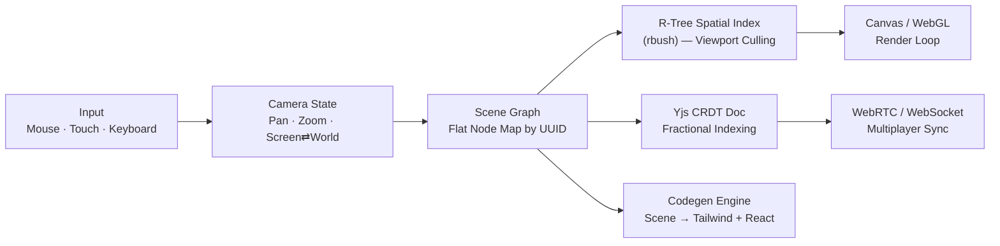

<div align="center">

# Vektor

**The local-first, infinite-canvas design tool that exports straight to clean Tailwind & React — no cloud required.**

[](https://github.com/Talha-Yaseen-Hub/Vektor)

[Why Vektor](#-why-vektor) · [Architecture](#-architecture) · [Roadmap](#-roadmap) · [Tech Stack](#-tech-stack) · [Quickstart](#-quickstart) · [Contributing](#-contributing)

[](LICENSE)
[]()
[](#-contributing)
[](https://github.com/Talha-Yaseen-Hub/Vektor/stargazers)

</div>

---

<div align="center">

### 🎥 Demo

> _A 10-second clip of multi-cursor editing and live Tailwind export lands here once the renderer (Phase 1) ships._
> _Want to help get there sooner? See [Contributing](#-contributing)._

</div>

---

## 🧭 Why Vektor

Figma solved collaborative design. It didn't solve **owning your tools** — the enterprise tier is heavy, closed-source, cloud-only, and hands developers a screenshot to "inspect" instead of code. Vektor is a bet on a different shape:

- 🔒 **Zero cloud required** — runs fully local-first; documents live in IndexedDB, not someone else's server
- 🧬 **Git-native** — designs are version-controllable JSON, diffable and mergeable like code, not binary blobs
- 🧑‍💻 **Developer-first** — built-in auto-layout compiles straight to Tailwind + React, no "inspect and guess" handoff
- 🤝 **CRDT multiplayer** — real-time collaboration via Yjs with fractional indexing, no server-side lockstep
- ⚡ **Built for scale** — R-Tree spatial indexing keeps thousands of shapes rendering at 60fps

**Vektor is in early, active development — and it's genuinely open for contributors.** The architecture below is largely decided; the implementation is where help is most valuable. Jump to [Contributing](#-contributing) if that's interesting.

---

## 🏛 Architecture

Every node lives in a flat relational map keyed by UUID — not a nested tree — so mutations stay O(1) and the structure syncs cleanly over a CRDT without recursive merge logic.



**Zoom that doesn't drift.** The point under your cursor stays locked in world-space while you scroll or pinch — the camera's pan offset is re-solved every frame, not just its scale:

$$T_x' = x_s - (x_s - T_x) \cdot \frac{S_{new}}{S_{old}}$$

A handful of the decisions baked into that diagram:

| System | Decision | Why |
|---|---|---|
| **Scene graph** | Flat `Map<NodeId, Node>`, ordered `childIds` for z-index | Avoids recursive mutation; trivial to diff and sync |
| **Spatial index** | R-Tree (`rbush`) queried against viewport AABB every frame | Renders thousands of shapes without walking the whole tree |
| **Collaboration** | Yjs CRDT + fractional-indexing for layer order | Two people can reorder layers at once with no server lockstep |
| **Layout** | Yoga Layout compiled to WASM | Real flexbox math for auto-layout frames, not an approximation |
| **Persistence** | IndexedDB binary snapshots (`Y.encodeStateAsUpdate`) | Full offline-first editing, no account or server required |
| **Export** | AST walk from scene node → Tailwind utility classes + JSX | Code-gen that reads like a human wrote it, not inline styles |

---

## 🗺 Roadmap

Vektor ships in five phases. Contributions are welcome at any phase — the earlier ones just have the most open ground.

| Phase | Objective | Status |
|---|---|---|
| **1 · Canvas Math & Primitives** | Viewport transforms, hit testing, rotation-aware bounding boxes | 🚧 In Progress |
| **2 · Tree Mutations & History** | Layer management, undo/redo via command pattern | ⬜ Planned |
| **3 · Text & Auto-Layout** | Yoga-powered flexbox engine, contenteditable text bridge | ⬜ Planned |
| **4 · CRDT Collaboration** | Multiplayer sync, ephemeral cursors, offline persistence | ⬜ Planned |
| **5 · Code Gen & Handoff** | Canvas → Tailwind/React compiler, SVG export | ⬜ Planned |

---

## 🧰 Tech Stack

<div align="center">


</div>

<div align="center">


-333333?style=flat-square)
-764ABC?style=flat-square)


</div>

---

## 🚀 Quickstart

**Prerequisites:** Node.js ≥ 18, pnpm

```bash
git clone https://github.com/Talha-Yaseen-Hub/Vektor.git
cd Vektor
pnpm install
pnpm dev
```

Since Vektor is early-stage, commands and scripts may evolve between phases — check back here if something's drifted.

---

## 🤝 Contributing

Vektor is early enough that contributors shape it, not just patch it. You don't need prior CRDT or canvas-rendering experience to help — plenty of the roadmap is self-contained.

- **Fork** the repo and branch off `main`
- **Pick a lane** — the [Roadmap](#-roadmap) above doubles as a map of what's open, from Phase 1 canvas math to Phase 5 code-gen
- **Open a draft PR early** — design discussion happens in the open, not after the fact
- **Ask first on anything structural** — open an issue or discussion before reworking the scene-graph or CRDT schema, since those decisions ripple everywhere

If you're looking for a first contribution and nothing's tagged yet, open a discussion — early-stage repos move fast and issue labels lag behind.

---

## 📄 License

Vektor is released under the [MIT License](LICENSE) — permissive by design, so it's free to use, fork, and build on while the project grows through its early, contributor-shaped stages.

---

<div align="center">

### 👤 Author & Maintainer

**Talha Yaseen**
Software Engineer · Building Vektor in public

[](https://github.com/Talha-Yaseen-Hub)
[](https://talha-yaseen.vercel.app/)
[](mailto:talhavectorarts@gmail.com)

*⭐ Star the repo to follow progress — new architecture notes and demo clips land here as phases ship.*

</div>
